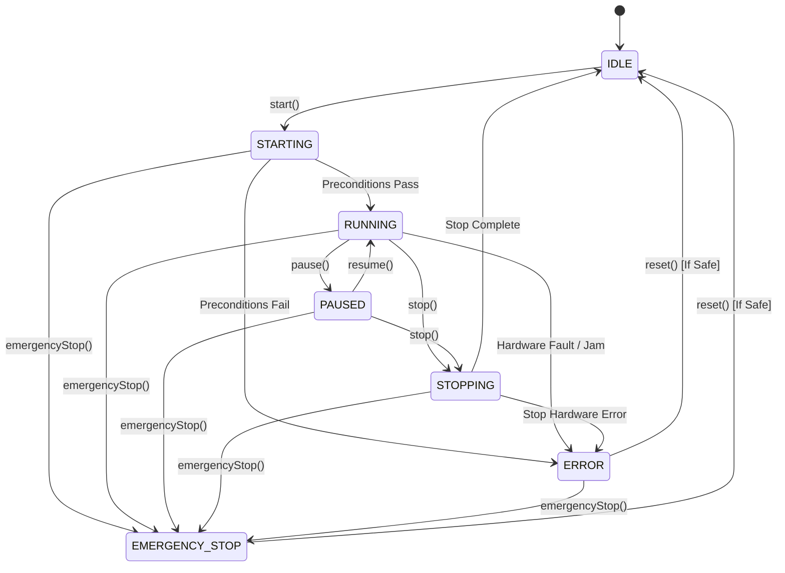

# Phase 4 — High-Level Controller & State Machine

## Step 1: Machine Finite State Machine (FSM) & Safety Controller Foundation

### A. Purpose of Phase 4 Step 1
Phase 4 Step 1 introduces the high-level decision-making and operational lifecycle layer of the **SmartWaste** system. Sitting above the `HardwareManager` and `SystemHealthMonitor`, the `MachineFSM` (Finite State Machine) and `SafetyController` enforce deterministic machine states, valid lifecycle transitions, safety interlocks, and immediate emergency-stop safety responses without directly manipulating simulated hardware components.

---

### B. Machine States
The machine lifecycle is governed by seven strongly-typed enum states (`smartwaste::core::MachineState`):

| State | Description |
| :--- | :--- |
| `IDLE` | Safe, static state. Initial state upon startup or after clean reset. Hardware inactive. |
| `STARTING` | Transient startup state. Performs safety pre-flight interlock checks before powering hardware. |
| `RUNNING` | Active operational state. Conveyors and sensors active, waste processing enabled. |
| `PAUSED` | Suspended operational state. Motor and belt paused, state preserved for quick resumption. |
| `STOPPING` | Controlled shutdown sequence state. Brings belt and actuators to a graceful stop before entering `IDLE`. |
| `ERROR` | Operational fault state triggered by hardware jam, sensor fault, or health monitor critical error. |
| `EMERGENCY_STOP` | Hard safety stop state triggered immediately on safety breach or manual E-stop trigger. All hardware stopped instantly. |

---

### C. Valid Transitions

---

### D. Invalid Transitions & Enforcement
Any attempt to transition outside the deterministic state transition graph is strictly rejected and logged as a warning. Examples of rejected invalid transitions:
- `IDLE -> RUNNING`: Direct jump to running bypasses safety pre-flight check in `STARTING`.
- `IDLE -> PAUSED`: Cannot pause a machine that is not running.
- `IDLE -> STOPPING`: Cannot initiate stop sequence from idle.
- `ERROR -> RUNNING`: Cannot directly resume operations from a fault state without explicit reset.
- `EMERGENCY_STOP -> RUNNING`: Direct restart after emergency stop is prohibited for operator safety.

---

### E. MachineFSM Architecture
The `MachineFSM` class (`src/controller/MachineFSM.hpp`, `src/controller/MachineFSM.cpp`) acts as the state machine controller:
- **State Ownership**: Encapsulates internal `MachineState` and protects transitions with mutex synchronization (`std::mutex`).
- **Hardware Abstraction**: Receives a reference to `HardwareManager` and `SafetyController`.
- **Public API**:
  - `start()`: Initiates transition `IDLE -> STARTING`. If safety checks pass, transitions to `RUNNING` and starts hardware. If safety fails, transitions to `ERROR`.
  - `pause()`: Suspends active operation (`RUNNING -> PAUSED`), stopping conveyor motion.
  - `resume()`: Restores active operation (`PAUSED -> RUNNING`), restarting hardware.
  - `stop()`: Performs controlled shutdown (`RUNNING/PAUSED -> STOPPING -> IDLE`), stopping hardware safely.
  - `emergencyStop()`: Triggers instant safety stop from any state (`-> EMERGENCY_STOP`), invoking `HardwareManager::stopAll()`.
  - `reset()`: Recovers from `ERROR` or `EMERGENCY_STOP` to `IDLE`, provided `SafetyController` verifies hardware health.

---

### F. SafetyController Architecture
The `SafetyController` class (`src/controller/SafetyController.hpp`, `src/controller/SafetyController.cpp`) isolates safety rule evaluation from state management:
- **Interlock Verification**: Checks telemetry and system health from `HardwareManager`.
- **Pre-flight Checks**: Evaluates motor speed, sensor status, gate jams, and health warnings.
- **Rule Engine**:
  - `canStartMachine()`: Returns true only if hardware health is `OK` and no critical gate/motor faults exist.
  - `isSafeToRun()`: Validates ongoing health during `RUNNING` state.
  - `requiresEmergencyStop()`: Evaluates if critical faults require immediate system shutdown.
  - `isSafeToReset()`: Verifies faults are cleared before allowing recovery to `IDLE`.

---

### G. Safety Interlocks
1. **Startup Guard**: `MachineFSM::start()` checks `SafetyController::canStartMachine()`. If a gate jam or motor fault exists, start fails and state transitions to `ERROR`.
2. **Runtime Protection**: Runtime fault detection transitions state to `ERROR` or `EMERGENCY_STOP` and halts conveyor belts.
3. **Reset Interlock**: Machine cannot reset to `IDLE` if gate jams or critical faults remain active.

---

### H. Emergency Stop Behavior
- `emergencyStop()` takes priority over all other state transitions.
- Can be invoked from any state (`IDLE`, `STARTING`, `RUNNING`, `PAUSED`, `STOPPING`, `ERROR`).
- Immediately calls `HardwareManager::stopAll()` to stop all motors and conveyor belts.
- Transitions state deterministically to `EMERGENCY_STOP`.

---

### I. Error Recovery
- Errors move state to `ERROR`.
- Machine remains in `ERROR` until explicit call to `reset()`.
- `reset()` queries `SafetyController::isSafeToReset()`. If true, transitions state to `IDLE`.
- Machine never automatically transitions from `ERROR` to `RUNNING`. Operator intervention (reset -> start) is strictly required.

---

### J. Dependency Inversion Verification
`MachineFSM` and `SafetyController` strictly comply with dependency inversion principles:
- **No Direct Hardware Concrete Headers**: Do NOT include `SimulatedConveyor.hpp`, `SimulatedMotor.hpp`, `SimulatedSensor.hpp`, or `SimulatedGate.hpp`.
- **Abstraction Layer Reliance**: Depend entirely on `HardwareManager`, `HardwareTelemetry`, HAL interfaces (`IConveyor`, `IMotor`, `ISensor`, `IGate`), and `SystemHealthMonitor`.

---

### K. Testing Overview
Unit tests in `tests/unit_tests.cpp` verify:
1. Initial state is `IDLE`.
2. Valid transition paths (`IDLE -> STARTING -> RUNNING`, `RUNNING -> PAUSED -> RUNNING`, `RUNNING -> STOPPING -> IDLE`).
3. Invalid transitions are rejected without mutating state.
4. E-stop priority from all states and hardware halt behavior.
5. Error state transitions and safe reset requirements.
6. SafetyController interlock blocking on gate jam and hardware faults.
7. End-to-end integrated scenario with simulated fault injection.

---

### L. Known Limitations
- **Simulation Layer**: This is a deterministic C++ simulation and control abstraction for educational/portfolio purposes. It is **not** a certified industrial safety controller (e.g., SIL 3 / IEC 61508 compliant).
- **Synchronous Execution**: State transitions and safety interlocks execute synchronously without background polling threads.

---

### M. Next Steps (Phase 4 Step 2)
In Phase 4 Step 2, we will implement:
- Sorting Decision Engine & Rules (routing categorized waste items to specific bin targets/gates).
- Integration between Waste Classification outputs and multi-gate sorting actions.
